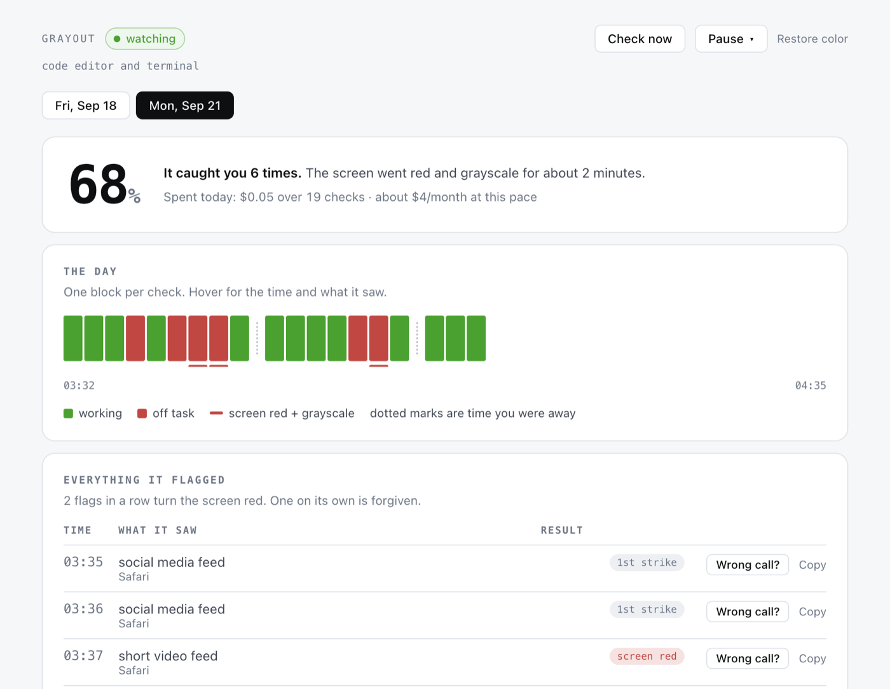

# Grayout for Mac

Your Mac goes gray until you get back to work.

Grayout is a menu-bar app. Every 45 seconds it looks at your screen and asks one question: is this person clearly not working? Two yeses in a row and every display loses its color and gets a red border. Color comes back the moment you get back to work. It never blocks, closes, or locks anything.

**$9.99 a month or $79 a year, plus tax where it applies. 100 checks free first, no card.** The app is the whole product; there is nothing to configure and no API key to get.

> **Status (2026-10-15): subscriptions are not open yet.** This README describes Grayout 2.0, which is built in this repository but not released. The latest release, 1.0.1, runs on your own OpenAI or Anthropic key (see Self-hosting). The Grayout service is not deployed yet either: until the deploy step fills in its address (`DEFAULT_API_BASE` in [`src/config.js`](src/config.js)), a 2.0 build says "not connected to the Grayout service yet" and sends nothing to it. A Mac App Store edition for the United States is built from the same code; it is not on the App Store yet.



*The 1.x dashboard, on a day with a few flags. On the subscription, the spend line shows the checks used this period instead.*

Site: https://aarushkandukoori.github.io/grayout/

## Download

Grayout comes two ways from this one codebase: the **direct download** from GitHub (or Homebrew), and a **Mac App Store edition** for the United States that is not listed yet.

### Direct download (worldwide)

- Apple Silicon: https://github.com/aarushkandukoori/grayout/releases/latest/download/Grayout-arm64.dmg
- Intel: https://github.com/aarushkandukoori/grayout/releases/latest/download/Grayout-x64.dmg

macOS 13 (Ventura) or later. Not yet notarized, so the first launch takes three extra clicks (below).

Not sure which one you have: Apple menu > About This Mac. "Chip: Apple M…" means Apple Silicon.

Or with Homebrew:

```bash
brew install --cask aarushkandukoori/tap/grayout
```

To verify a download, compare it against `SHA256SUMS.txt` on the release page:

```bash
shasum -a 256 ~/Downloads/Grayout-arm64.dmg
```

### Mac App Store (United States, coming soon)

**Not listed yet.** When it is, it will be listed as "Grayout: Back to Work" (the name "Grayout" is taken on the App Store; in the app it is still Grayout), only in the United States storefront, and linked from here and from the [download page](https://aarushkandukoori.github.io/grayout/download.html#mac-app-store). It is the same app with the same checks and the same Grayout Pro, bought on the web through Stripe, never through Apple. It runs inside Apple's App Sandbox, updates through the App Store, and draws the gray with an overlay window instead of macOS's Color Filters switch.

### Which should I pick?

| | Direct download | Mac App Store edition |
|---|---|---|
| Where | Everywhere | United States storefront only |
| Available | Yes (1.0.1 today) | Not listed yet |
| First launch | Three extra clicks while it is not notarized | No warning |
| Updates | "Update available" in the menu, or `brew upgrade` | The App Store |
| The gray | macOS's Color Filters switch, through a small helper | A click-through overlay window from a sandboxed helper that exits with the app |
| Own API key, Claude CLI engine, Canvas, task file | Yes | No, always the Grayout service |
| Grayout Pro | Bought on the web through Stripe | The same, never through Apple |
| Data folder | `~/Library/Application Support/Grayout/` | `~/Library/Containers/com.aarushkandukoori.grayout/Data/Library/Application Support/Grayout/` |

Use one at a time: two copies would both try to gray the screen. Settings and a saved license key don't carry over between them. On the other one, paste your key in Settings > Your plan and click Activate; in the Mac App Store edition, click Connect an existing subscription first.

## First launch on macOS

### Direct download

Grayout is a one-person project and is not yet in Apple's notarization program, so macOS warns you once. The full walk-through is at https://aarushkandukoori.github.io/grayout/download.html#first-run.

1. **Download and drag.** Open the DMG, drag Grayout onto the Applications folder, eject. It must be in Applications for the Open Anyway exception and Start at login to work.
2. **First launch.** Double-click Grayout in Applications. macOS shows: *Apple could not verify "Grayout" is free of malware that may harm your Mac or compromise your privacy.* with buttons **Done** and **Move to Trash**. Click **Done**. (Control-click > Open no longer bypasses this on macOS 15 and 26.)
3. **Allow it.** Open System Settings > Privacy & Security, scroll down to the Security section. You'll see *"Grayout" was blocked to protect your Mac.* Click **Open Anyway**, enter your password or use Touch ID, then click **Open Anyway** (or **Open**) in the dialog that follows. macOS remembers this. Some guides report the Open Anyway button disappears about an hour after the blocked attempt; if you don't see it, double-click Grayout again and come back.
4. **Allow it, turn on Screen Recording, then start.** Onboarding first lists what is sent at each check and who receives it, and captures nothing until you click **Allow and continue**. Then it walks you through the permission and a relaunch, shows you the gray once so you know what it looks like, and starts watching. There is no key to paste and no account to create: your first 100 checks run immediately.

Terminal alternative that skips the Gatekeeper dialog:

```bash
xattr -dr com.apple.quarantine /Applications/Grayout.app
```

Why: removing this warning requires Apple's $99/year Developer Program and notarization. That is the first thing on the roadmap.

### Mac App Store edition

No Gatekeeper steps: apps from the App Store open without a warning. Open Grayout, read what it sends and to whom, click **Allow and continue**, then follow step 4 above from the Screen Recording part on.

## What it costs

| Plan | Price | What you get |
|---|---|---|
| Free taste | $0, no card, no account | 100 checks, about 2 hours of watched work |
| Pro monthly | $9.99 a month plus tax where it applies, 7-day free trial | 10,000 checks a month |
| Pro yearly | $79 a year plus tax where it applies (34% off) | 10,000 checks a month |

**Free taste.** The first 100 checks need nothing from you: no card, no email, no sign-in. They are tied to this install, so they are a taste of the product, not a free tier. A check is spent only when you are at the Mac and something on screen actually changed, so 100 of them cover roughly 2 hours of watched work: long enough to see it gray you out, and long enough to see it leave you alone while you work. The service also caps free checks per network (300 a month, however many installs it has) and for everyone each day, so on a very busy day free checks can pause until midnight UTC.

**Trial.** Monthly carries a 7-day free trial. You enter a card, you are not charged until day 8, and cancelling inside the week costs nothing. There is one trial per Mac, per email address and per card: a second trial with the same email or card is charged straight away. Stripe sends no reminder before a 7-day trial ends, so Grayout shows one notification about two days before, if it is running then.

**Subscribing.** Click Subscribe in the menu bar. Grayout opens Stripe's checkout page in your browser; when you finish paying, the app unlocks itself within a few seconds. There is nothing to copy and no password to invent. If you already have a license key (a second Mac, a reinstall), paste it in Settings > Your plan instead (in the Mac App Store edition, under Connect an existing subscription).

**Who you pay.** Grayout Pro is sold through Link: Stripe is the merchant of record. It works out and collects any sales tax or VAT, sends the receipts, and answers payment questions. Your card statement shows LINK.COM*. That is true in the Mac App Store edition too: the app is free there, and Grayout Pro is bought on the web through Stripe, never through Apple, so Apple doesn't bill, cancel or refund it.

**The allowance.** 10,000 checks a month is above ordinary use. A full month of watched work at the default interval is around 8,000 checks, and change-gating (below) removes roughly half of those, so a typical month uses about 4,000. If you somehow pass 10,000, the service slows down rather than cutting you off: one check every 10 minutes until the count resets at 00:00 UTC on the 1st. During the free trial the allowance is 1,000 checks, more than a week of real use.

**Managing or cancelling.** Settings > Manage subscription opens Stripe's billing portal, where you can change the card, switch plans, or cancel. You can also manage it at link.com, where this purchase is listed as Sold through Link. Cancelling leaves the app installed and watching until the period you paid for ends. A full refund or a card dispute ends the subscription and its key at once.

**Change-gating** is why $9.99 works. Before spending a check, Grayout compares a small hash of each display against the previous one. If nothing on any display changed and the frontmost app is the same and no alert is running, it skips the call and keeps the last verdict. A real check runs at least every `forceCheckSec` (180 seconds by default) regardless, so a screen that is deliberately held still is still caught. Set `changeGating` to `false` if you would rather pay for every interval.

## Permissions

Grayout needs one permission, Screen Recording. Everything else below is optional or a one-time prompt, and it never asks for Accessibility, Automation, or Full Disk Access.

- **Screen Recording** (required). Onboarding step 2 opens System Settings > Privacy & Security > Screen Recording. Turn on Grayout, then click Relaunch Grayout. macOS applies this permission only after the app restarts. Grayout reopens at the next step.
- **Camera** (optional, off by default). Only if you turn on the webcam option. macOS asks the moment you flip the toggle, and you can revoke it any time in System Settings > Privacy & Security > Camera.
- **Login item** (optional). Start at login uses the system login-item service and only works when Grayout is in /Applications. If macOS says it needs approval, the Permissions menu links to Login Items settings.
- **Keychain.** When Grayout saves your license key, macOS asks once whether it may use its own Keychain item ("Grayout Safe Storage"). Click **Always Allow**.

On the direct download, macOS sometimes reports Screen Recording as allowed while captures come back blank after an update (the Mac App Store edition's signature stays the same across updates, so this should not happen there). Turn Grayout off and on in the Screen Recording list, or reset the grant and grant it again (the tray's Permissions menu has a Copy the fix command item for this):

```bash
tccutil reset ScreenCapture com.aarushkandukoori.grayout
```

## How it works

Nothing below runs until you allow it: onboarding shows what is sent at each check and who receives it, and the loop never captures without that permission. Turning off **Send screenshots for checks** in Settings withdraws it and stops the checks.

1. Every 45 seconds (configurable) the loop checks its guards: paused, screen locked, idle for 10 minutes, daily cap reached, or inside the 10-minute grace after you clicked I'm working. Any of those, and nothing is captured.
2. It reads the frontmost app's name: with `lsappinfo` on the direct download, or from the bundled overlay helper (which asks `NSWorkspace`) on the Mac App Store edition. Neither needs a permission. A password manager in front means no capture at all. A video-call app in front clears any alert and skips the check.
3. It captures every display (up to three) with `/usr/sbin/screencapture`, shrinks each to at most 1366 px wide (and 2732 px tall, for a portrait display), encodes it as a JPEG, and deletes the file. Mirrored displays are deduplicated.
4. Change-gating compares each display against the previous check. Nothing changed, same frontmost app, no alert running: the call is skipped and the previous verdict stands, until `forceCheckSec` forces a real one.
5. It sends the images, the frontmost app's name, and optionally your one-line work description and task titles, to the Grayout service, which asks OpenAI's vision model and returns a three-field verdict: `off_task`, `activity`, `confidence`. The prompt lives on the service, so judgement improves without you installing anything.
6. A strike is counted only when `off_task` is exactly `true` with `high` confidence. Anything else, including an error, a refusal, an expired subscription, or a malformed answer, resets the strike count to zero. Grayout fails toward leaving you alone.
7. Two strikes in a row: a red border on every display and grayscale (macOS's Color Filters switch on the direct download; a click-through overlay window on the Mac App Store edition). The next on-task verdict, I'm working, Pause, Quit, or the 20-minute watchdog restores color.

The prompt tells the model that a video call or screen share is work, that anything ambiguous is work, and to name only the category of what it sees, never on-screen text. The self-hosted prompt, which is the same shape, is in [`src/analyzer.js`](src/analyzer.js).

## What leaves your Mac

Only after you allow it in onboarding. Sent to the Grayout service (the address in [`src/config.js`](src/config.js)) at each check that is not skipped:

- A resized screenshot of each display.
- The name of the app in front.
- A webcam frame, only if you turned the camera on.
- Your one-line work description, if you wrote one.
- Titles of your Canvas to-do items or your task file's unchecked lines, if you configured either (direct download only). They are fenced and labeled as untrusted data in the prompt.
- Your device id and device token, plus your license key once you subscribe, so the service can count free checks or confirm the plan.

The service forwards the images to OpenAI, gets the verdict, and returns it. It does not store the images and does not log them. OpenAI does not train on API data, and under its API data policy it may keep inputs for up to 30 days to check for abuse. What it keeps: a random device id and its free-check count, a license record with the subscription state copied from Stripe (a hash of the key, never the key, and no name, email or card), monthly check counts, and, only to stop abuse, keyed hashes of your network address (48 hours for registering devices, a month for free checks) and of the email and card that started a trial (a year). [PRIVACY.md](PRIVACY.md) lists every field.

The only other connections are an anonymous version check against `api.github.com` once a day, which you can turn off in Settings, and your Canvas host if you configured one. Both are direct download only: the Mac App Store edition gets updates from the App Store and never contacts GitHub. Stripe handles payment on its own pages in your browser; Grayout never sees your card number.

Stored on your Mac in `~/Library/Application Support/Grayout/` (Mac App Store edition: `~/Library/Containers/com.aarushkandukoori.grayout/Data/Library/Application Support/Grayout/`): your settings, whether and when you allowed checks, the encrypted license key, a 30-day log of short category phrases like "code editor and terminal" (one line per check, deletable from Settings), and a rotating app log that never contains prompt text, images, or your key.

The full policy is in [PRIVACY.md](PRIVACY.md). If you would rather send nothing to us at all, see Self-hosting.

## Escape hatches for a stuck gray screen

### Direct download

On the direct download, grayscale is macOS's Color Filters setting, which outlives the process, so Grayout has seven ways back to color:

1. Grayout turns grayscale off on every launch, before it does anything else. Relaunching the app restores color. If the menu doesn't respond, force quit it first (see Force quitting, below).
2. Color is restored on quit, on a crash, on SIGINT and SIGTERM, on an uncaught exception, and on system shutdown.
3. A watchdog restores color after 20 minutes of gray no matter what (`maxAlertMinutes`).
4. The menu-bar item **Restore color now** works in every state, including paused, blocked, and unsubscribed.
5. The helper binary can be run by hand:

   ```bash
   "/Applications/Grayout.app/Contents/Resources/helper/grayscale" off
   ```

6. Without a terminal: System Settings > Accessibility > Display > **Color Filters**, and turn it off. That is the exact switch the direct download uses, so this always works.
7. Onboarding's **Preview the gray** proves the restore path on your Mac before the loop is armed.

### Mac App Store edition

The gray is a set of click-through windows drawn by a small helper process (`grayout-overlay`) that Grayout starts and talks to over a pipe. The helper exits as soon as that pipe closes, and checks every second that Grayout is still its parent, so the gray cannot outlive the app, even after a crash or a force quit. It never changes a display setting, so there is nothing to reset in System Settings. Ways back to color:

1. **Restore color now** in the menu bar, in every state.
2. **I'm working**, when it is shown.
3. Pause, or Quit. A force quit works too, because the helper goes with the app.
4. The watchdog restores color after 20 minutes no matter what (`maxAlertMinutes`).
5. Onboarding's **Preview the gray** shows the restore path before the loop is armed.

### Force quitting

Grayout is a menu bar app (`LSUIElement`), so it usually isn't listed in the Force Quit window (Option-Command-Esc). Open Activity Monitor, select Grayout, click Stop (the X button), then Force Quit, or run `killall -9 Grayout` in Terminal. Plain `killall` sends SIGTERM, which a hung Grayout can't act on. The gray is click-through, so both work while it is on. In the Mac App Store edition the gray goes with the app; on the direct download, Color Filters stays on until you relaunch Grayout or switch it off (direct download items 1 and 6).

Nothing to do with billing can leave your screen gray. A license that lapses, a failed payment, an exhausted free taste, or an unreachable service all stop checks; they never start an alert.

If none of these work, open an issue with the "My screen is stuck gray" template.

## Self-hosting

**Direct download and source builds only.** The Mac App Store edition always uses the Grayout service: it has no own-key mode or Claude CLI engine, ignores `provider`, `apiBase` and `engine`, and does not read Canvas or a task file.

**Grayout is MIT-licensed and the whole app is in this repository.** If you would rather not pay a subscription, or would rather no screenshot ever passed through a machine of ours, you can run it against your own Anthropic or OpenAI key. This is a build-from-source path, it is not what the packaged app is set up for, and it gets no support beyond the repository. It is not going away.

Set `provider` in `~/Library/Application Support/Grayout/config.json` to the provider whose key you hold. That disables the Grayout service entirely: no license check, no call to the Grayout service, no subscription, and the app calls the provider directly under your key.

```jsonc
{
  "provider": "openai",          // or "anthropic"; "grayout" forces the subscription
  "model": "gpt-5-mini",         // or "claude-haiku-4-5" with an Anthropic key
  "changeGating": true,          // keeps your own bill down too
  "forceCheckSec": 180
}
```

The default, `"auto"`, does this on its own: a Mac with a model key saved self-hosts on that key's provider, and a Mac without one uses the subscription. Setting `provider` explicitly is how you stop that from depending on what happens to be in your Keychain.

Then run it from source with the key in the environment:

```bash
git clone https://github.com/aarushkandukoori/grayout && cd grayout && npm ci && npm run helper
OPENAI_API_KEY=sk-... npm start       # or ANTHROPIC_API_KEY=sk-ant-...
```

Costs you pay directly to the provider, at list prices as of 2026-09-22, for one display with change-gating on:

| Provider and model | Per check | A month of watched work (about 4,000 checks) |
|---|---|---|
| OpenAI, `gpt-5-mini` | about $0.0007 | about $3 |
| Anthropic, `claude-haiku-4-5` | about $0.0025 | about $10 |

The webcam adds about 15%. Each additional display roughly doubles the per-check cost. `dailyCheckCap` (1,200 checks) is the hard stop. A workspace spend limit at console.anthropic.com, or a project budget at platform.openai.com, is the simplest real cap.

You can also run the service yourself: `server/` is the Cloudflare Worker, and `apiBase` points the app at your own deployment. Endpoints and payloads are in [docs/API-CONTRACT.md](docs/API-CONTRACT.md).

## Settings and advanced config

The common settings are in the dashboard (menu bar > Settings…). Everything lives in `~/Library/Application Support/Grayout/config.json`; hand edits are picked up within a couple of seconds, and Settings > Advanced opens the file in your editor. Values outside the ranges below are clamped; a file that does not parse is copied to `config.json.invalid` and defaults are used until you fix it.

| Key | Default | Range or type | What it does |
|---|---|---|---|
| `checkIntervalSec` | `45` | 10 to 3600 | Seconds between checks. Settings offers 30, 45, 60, 90, 120. |
| `strikes` | `2` | 1 to 20 | Consecutive high-confidence off-task verdicts before the screen reacts. |
| `changeGating` | `true` | boolean | Skip the check when no display changed and the frontmost app is the same. Off means every interval spends a check. |
| `forceCheckSec` | `180` | 30 to 3600 | Run a real check at least this often even when nothing changed. |
| `idleSkipSec` | `600` | 30 to 86400 | After this long with no keyboard or mouse input, checks stop. An existing gray is held, not cleared. |
| `heldAlertRecheckSec` | `300` | 60 to 3600 | While idle and gray, still run one check this often so a wrong gray corrects itself. |
| `maxAlertMinutes` | `20` | 1 to 240 | Watchdog: color always comes back after this long. |
| `disputeGraceMin` | `10` | 1 to 120 | How long I'm working keeps the screen from going gray again. |
| `wakeGraceSec` | `45` | 0 to 600 | Wait after unlock or wake before the first check. |
| `dailyCheckCap` | `1200` | 50 to 20000 | Checks per local day. When reached, checks pause until tomorrow. |
| `camera` | `false` | boolean | Send a webcam frame with each check. |
| `grayscale` | `true` | boolean | Use system-wide grayscale as the consequence. Off means red border only. |
| `redFlash` | `true` | boolean | Red border on every display while off task. |
| `pauseWhenLocked` | `true` | boolean | No checks while the screen is locked or the Mac is asleep. |
| `alwaysAllowedApps` | `["zoom.us", "FaceTime", "Microsoft Teams", "Webex", "Google Meet", "Discord"]` | list of strings | Frontmost app names that never trigger and clear an alert. Case-insensitive substring match. |
| `neverCaptureApps` | `["1Password", "Bitwarden", "Passwords", "Keychain Access"]` | list of strings | Frontmost app names that are never captured. Applies to the frontmost app only; other windows may still be visible in a capture. |
| `workDescription` | `""` | up to 500 characters | One line telling the model what your work looks like. |
| `logVerdicts` | `true` | boolean | Append each verdict to `verdicts.jsonl`. Off means an empty dashboard. |
| `startAtLogin` | `false` | boolean | Register a login item (only when in /Applications). |
| `checkForUpdates` | `true` | boolean | Anonymous daily version check against api.github.com. Direct download only; the Mac App Store edition never checks. |
| `historyDays` | `30` | 1 to 365 | `verdicts.jsonl` is pruned to this many days at launch and once a day. |

Advanced keys with no UI, edited in `config.json` directly. Apart from `schemaVersion`, they are for the direct download and source builds only; the Mac App Store edition ignores them.

| Key | Default | Range or type | What it does |
|---|---|---|---|
| `provider` | `"auto"` | `auto`, `grayout`, `anthropic`, or `openai` | Where checks go. `auto` means the subscription, unless a model key is saved on this Mac, in which case it self-hosts on that key's provider. `grayout` forces the subscription and ignores any saved key. `anthropic` and `openai` force self-hosting on that provider. |
| `apiBase` | `""` | https URL, or empty | The Grayout service to talk to. Empty means the address built into the app (`DEFAULT_API_BASE` in `src/config.js`, filled in at deploy time; a build where it was never filled in is "not connected" and sends nothing). Only https is accepted, except `http://localhost`, and anything else is ignored rather than used. Change it only to point at a deployment of `server/` that you run. |
| `model` | `"claude-haiku-4-5"` | any `claude-*` or `gpt-*` model your key can use | Self-hosting only. If it does not belong to the active provider's family, the provider default applies: `claude-haiku-4-5` for Anthropic, `gpt-5-mini` for OpenAI. On the subscription the service picks the model. |
| `canvas.baseUrl` | `"https://canvas.cmu.edu"` | https URL | Your Canvas LMS host. |
| `canvas.token` | `""` | string | A Canvas API token. Paste it here once; on the next load Grayout moves it into the Keychain and blanks this field. Titles of your to-do and planner items (up to 20) are then sent with each check as fenced, untrusted context, refreshed every 10 minutes. |
| `tasksFile` | `""` | absolute path | A Markdown file. Its unchecked lines (`- [ ] task`, up to 20) are sent with each check as fenced, untrusted context. |
| `engine` | `"api"` | `api` or `cli` | `api` is the subscription or your own key, as `provider` decides. `cli` runs each check through the local `claude` CLI (Claude Code) on its Claude subscription login instead: no Grayout plan, no model key, no per-check charge inside the Claude plan, and each check counts toward that plan's usage limits. The Grayout service is never contacted for checks, and `provider`, a saved key and a license are all ignored; a CLI failure never falls back to any of them. Frames go to the CLI over stdin, never to disk, and it runs with no tools, no MCP servers, no hooks, no user settings, no auto-memory and no saved session, in an empty folder of its own. Its environment is only `HOME`, `USER`, `LOGNAME`, `SHELL`, `TMPDIR`, the locale and proxy variables: API keys, `ANTHROPIC_BASE_URL`, Bedrock/Vertex switches and OAuth token overrides are never passed on. `@` in your work description, task titles and app names is sent as a fullwidth `＠` so the CLI cannot read it as a file to attach. Change-gating applies as usual. Each check starts a CLI process of about 250 MB that uses about 4 CPU-seconds, roughly 8% of one core at the default 45-second interval; `checkIntervalSec` of 60 to 90 halves that. |
| `cliPath` | `""` | full path, `~/` allowed | The `claude` binary, or a drop-in wrapper, for `engine: "cli"`. Empty searches `~/.local/bin`, `/opt/homebrew/bin` and `/usr/local/bin` and uses that claude's own login (the one `claude auth login` set up). A path that is missing or not executable is kept as written, and checks stop with "Claude CLI not found" until you fix it, rather than switching to another binary. A wrapper that fails over between accounts can only do so if it handles `-p --input-format stream-json` with piped stdin as a one-shot run; Grayout sets `CLAUDE_FAILOVER_ONESHOT_STDIN=1` for wrappers that support it. If the CLI is logged out, the status line says how to log it back in (`claude auth login` for a plain `claude`), then Check now. |
| `cliAllowOverage` | `false` | boolean | `engine: "cli"` only. When the Claude plan's limit is used up and the account has extra usage turned on, the CLI keeps answering and each check is billed at API prices. Off: after the first such check (logged with its cost), checks pause until the limit resets. On: they keep running and the cost meter counts them. |
| `schemaVersion` | `1` | | Leave as `1`. |

If `config.json` stops being valid JSON while Grayout runs, it keeps the last good settings and tells you once. If it is invalid at launch, checks stay paused (and Settings won't save over it) until the file parses again, rather than running on the defaults; Grayout reloads it on its own.

Data folder layout: `config.json`, `secrets.bin` (Keychain-encrypted, holds the license key), `state.json` (includes your device id and whether you allowed checks), `verdicts.jsonl`, `logs/grayout.log`. On the Mac App Store edition the same files live in `~/Library/Containers/com.aarushkandukoori.grayout/Data/Library/Application Support/Grayout/`. Settings > Reveal data folder opens it. Delete all history truncates `verdicts.jsonl` and nothing else. Erase this Mac's Grayout data deletes all of these files and restarts Grayout fresh; it does not cancel a subscription.

## Build from source

Needs Node 22 and the Xcode Command Line Tools (for `clang` and `swiftc`, which build the two small display helpers: `helper/grayscale` for the direct download and `helper/grayout-overlay` for the Mac App Store edition).

```bash
git clone https://github.com/aarushkandukoori/grayout && cd grayout && npm ci && npm run helper && npm start
```

Running from source uses the same data folder as the packaged app. Point it somewhere else with `GRAYOUT_USER_DATA` if you would rather not touch your real settings. Unpackaged, `GRAYOUT_API_BASE` overrides `apiBase`, and `ANTHROPIC_API_KEY` or `OPENAI_API_KEY` supply a self-hosting key; the packaged app ignores all three.

To try the Mac App Store edition's rules without packaging it, run `GRAYOUT_CHANNEL=mas npm start`: every App Store gate applies, though the app is not sandboxed. `GRAYOUT_GRAYSCALE_BACKEND=blend npm start` tries only the overlay gray in the direct build. A packaged app ignores both; a Mac App Store build is decided by Electron's `process.mas` alone. How that build is packaged and checked is in [docs/BUILD-SPEC.md](docs/BUILD-SPEC.md), section 27.

Other scripts:

```bash
npm test          # node --test 'tests/**/*.test.js' (plain Node, no Electron)
npm run check     # node --check on every JS file
npm run dist      # helper + Grayout-arm64.dmg and Grayout-x64.dmg in dist/
npm run verify:dmg dist/Grayout-arm64.dmg
npm run smoke:api # one real check against a synthetic frame
```

The service is a separate package in `server/`: `npm --prefix server test`, `npm --prefix server run dev` (wrangler), `npm --prefix server run deploy`.

## Updating

**Mac App Store edition.** Updates come through the App Store like any other app. Your license and settings survive, and it never checks GitHub.

**Direct download.** Download the new DMG, drag it over the old app, relaunch. Your license and your settings survive. Coming from 1.x with an API key already saved: that key is still there and still used, because `provider` defaults to `auto`. Set `provider` to `grayout` to move onto the subscription, or leave it alone to keep paying your provider directly. The tray shows "Update available" when a newer release exists. macOS may ask for Screen Recording again after an update; if the toggle is on but captures are blank, use Permissions > Copy the fix command.

## Uninstall

Cancel the subscription first, in Settings > Manage subscription, or later at any time at link.com, where it is listed as Sold through Link. Then turn off Start at login, quit Grayout, drag it to the Trash, and delete `~/Library/Application Support/Grayout`. For the Mac App Store edition, use Settings > Erase this Mac's Grayout data before you remove the app, or delete `~/Library/Containers/com.aarushkandukoori.grayout` afterwards. Deleting the app does not cancel anything on its own.

## Contributing

See [CONTRIBUTING.md](CONTRIBUTING.md). Bugs go to Issues using the templates; questions go to Discussions. Billing problems have their own template, and the rule there is simple: never paste a license key or a card number into a public issue.

## Not for employers

Grayout reports to nobody but you. There is no team dashboard, no admin console, and there never will be an employer edition. The service knows your license and a count of checks; it does not know what you were doing. If a workplace installs this on your machine, that is not what it is for.

## Security

See [SECURITY.md](SECURITY.md) for how to report a vulnerability and for the threat model, which now covers the service as well as the app.

## License

MIT. Copyright (c) 2026 Aarush Kandukoori. See [LICENSE](LICENSE).
